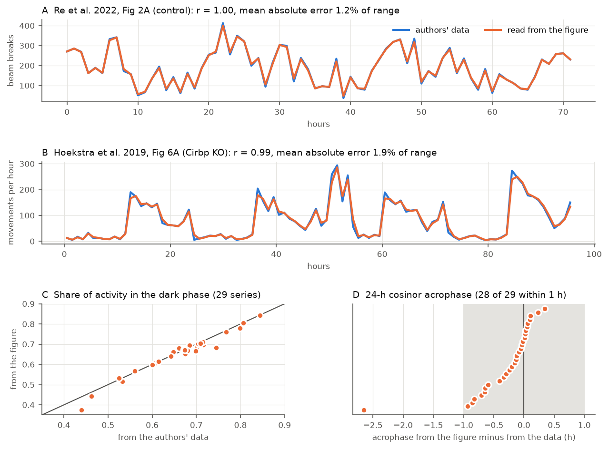

# Activity traces of mice and rats in published papers

The paper this package was written for read one figure: seven days of home-cage activity of CD157 knockout and
wild-type mice (Lopatina et al. 2014, Fig 4), digitised and analysed for its daily rhythm. This folder asks whether
that works in general, for the kind of figure it was written for: line traces of rodent activity over several days.

It holds 18 open-access papers (CC BY) and the activity traces of 32 panels of their figures, read with
trace-digitiser 2.2.0 in the way a user of the [workbench](https://comparativechrono.github.io/digitiser-workbench/)
would read them. The papers come in two kinds:

* **8 papers that published the numbers behind their traces.** For these the series each trace was drawn from is
  rebuilt from the authors' files, and the same rhythm analysis is run on the trace as read and on the authors'
  series. Whether a series is rhythmic, its phase, its amplitude and its share of activity in the dark can then be
  set side by side, like a model's predictions against held-out labels.
* **10 papers that did not.** For these what the authors say in the text about their traces — this group is less
  active at night, that rhythm persists in constant light — is checked against the traces as read.

In each kind some papers analysed their rhythms with a dedicated method (a periodogram, cosinor, JTK_CYCLE, phasor
analysis) and some did not (3 and 5 of those with data, 5 and 5 of those without).

Like the [published-figures](../published-figures/README.md) set beside it, this is not part of the test suite and
not in the package.

## In short

* **Values.** For the 29 series with data the trace as read correlates with the authors' series with a median
  r of 0.94 (0.96 once the figure's own placement in time is allowed for, below), and differs from it by a median
  of 5.9% of its range.
* **Rhythmic or not.** Run on the trace as read and on the authors' series, the Lomb–Scargle periodogram and the
  24-h cosinor give the same answer for all 29 series, and the chi-square periodogram for 21 of the 22 long enough
  for it. Cut into whole days, the 24-h cosinor gives the same answer for 63 of 69 days; on five of the other six
  the trace makes the day look rhythmic where the data fall just short of it (p 0.06–0.13).
* **Rhythm measures.** The share of activity falling in the dark phase is within 0.05 of the authors' for 27 of 29
  series (largest difference 0.07); the 24-h acrophase is within 1 h for 27 of 29 (the two that are not come from
  figures that place their points up to 2.3 h from their times, or at 2.5 px an hour); the cosinor amplitude is
  within 0.8–1.25 times the authors' for 22 of 29.
* **What the papers say.** Of 53 statements about the traces that a trace can test, the traces as read support
  46. In the papers with data the trace and the authors' series give the same verdict on 21 of 22 statements —
  including the four that neither supports (a figure legend says that blocking eNAMPT *abrogates* the circadian rhythm
  of activity; on the authors' own numbers, as on the figure, the rhythm is blunted but still there). Of the 31
  statements in the papers without data, the traces support 29; the two they do not are in the paper the submission
  analysed.

The rest of this file says how the papers were found, how each figure was read, how the series were analysed, and
what came out, figure by figure and statement by statement.



*A, B: two traces as read (orange) over the authors' hourly means (blue): one read almost exactly, one whose figure
draws each hour's mean at the end of its hour and draws each group's SEM band in the colour of its mean line.
C: share of activity in the dark phase, from the figure and from the data, for the 29 series with data. D: the
24-h cosinor acrophase from the figure minus from the data.*

## Running it

From the repository, with the version to test installed (`pip install -e .`) and pandas, openpyxl, SciPy and
matplotlib:

```bash
python validation/activity-traces/run.py                  # read every figure again, then analyse (about a minute)
python validation/activity-traces/run.py --keep-readings  # analyse the readings already in digitised/
python validation/activity-traces/run.py --overlays DIR   # also keep the package's overlay of each figure
python validation/activity-traces/tables.py               # the tables below, from results/
python validation/activity-traces/cd157.py                # the CD157 figure, from both copies (after run.py)
```

| File | What it holds |
|---|---|
| `papers.csv` | the 26 papers shortlisted, with each one's figure, data, rhythm analysis and whether it was kept |
| `figures/` | the figures as downloaded (one, a WebP, saved as PNG) |
| `configs/` | for each figure, what was given when reading it: plot area, colours, ticks where the labels could not be read |
| `cases.json` | each figure's light–dark schedule and how its series are cut (for example fed, fasted, refed) |
| `sources/` | the authors' data files (one workbook cut to the two sheets used) |
| `truth.py` → `truth/` | the series each figure was drawn from, rebuilt from `sources/`, one function per paper |
| `digitise_case.py` → `digitised/` | each trace as read, column by column; `VERSION` names the release that read them |
| `rhythm.py` | the rhythm analysis, the same for every series |
| `compare.py` → `results/` | every analysis of every series, and the trace and the data side by side |
| `claims.json`, `claims.py` | the statements in the papers about their traces, and how each is checked |
| `summarise.py`, `tables.py`, `summary_figure.py` | the agreement tables, the tables below and the figure above |
| `plot_case.py` | one figure's traces as read drawn over the authors' series, for looking at |
| `cd157.py` → `results/cd157*` | the CD157 figure read from both copies and analysed ([below](#the-cd157-figure)) |
| `run.py` | all of the above, in order |
| `search/` | the search and screening that found the papers |

## How the papers were found

On 15 November 2026 Europe PMC was searched (`search/search.py`) for open-access, CC BY papers whose figure legends
name rodent activity (locomotor, wheel-running, home-cage, beam breaks, activity counts...) together with days or
light–dark conditions, and mice or rats. That gave 3,950 papers, 3,921 of them in PMC. The 3,886 whose PMC record
gives a CC BY or CC0 licence were harvested from PMC's open-access bucket (`search/harvest.py`): figure legends, data
availability statements, supplementary files and any rhythm-analysis method named in the text. Each legend was scored
for activity shown as a line over consecutive days (`search/score.py`); 781 papers had a legend scoring 6 or more
(`search/screened.csv`), 224 of them with data files or a data repository. About 170 of their figures were looked at.
Narrower searches made afterwards (telemetry with cosinor analysis; metabolic-cage papers with source data) brought
in three more papers (one of them, Sayler & Hammond 2025, was in the first search but its legends scored below 6),
and the paper analysed in the submission (Lopatina et al. 2014) was added by hand.

A figure was shortlisted when it showed

* the activity of mice or rats as a line (not bars, an actogram, a 24-h average or daily totals),
* over at least about two days of continuous recording,
* in a paper licensed CC BY,
* about which the text says something: whether there is a rhythm, when the animals are active, how groups differ.

For the papers with data, the authors' files had to hold the plotted series or the per-animal values it was averaged
from. 26 papers were shortlisted (`papers.csv`). Looked at closely, at full size, 8 of them failed a criterion after
all: their activity was drawn as bars or filled areas (3), as a 24-h profile double-plotted (1), as spikes that leave
the plotted range in every light phase (1), as five timed samples a day (1), as two black lines told apart only by
their markers' fill (1), or with no statement about it in the text (1). That leaves the 18 papers below.

Figures were taken at the largest size the publisher serves (eLife's image server; Springer Nature's, Elsevier's and
Frontiers' full-size images; PLOS's "large" images; the image embedded in the article's PDF for MDPI) and otherwise
from PMC, whose copies are often about 700 px wide. Where each came from is in its configuration.

## The papers

PMC identifiers link to each paper. *Series* counts the series analysed (a trace cut into parts, such as fed and
fasted, counts once per part); *claims checked* counts the statements about the traces that a trace can test, and
those it cannot (a claim of no significant difference between groups needs the spread between animals, which a mean
trace does not hold).

| Paper | Figure | Data | Rhythm analysis in the paper | Series | Claims checked |
|---|---|---|---|---|---|
| Sayler & Hammond 2025, *PLoS One* ([PMC12370043](https://doi.org/10.1371/journal.pone.0323853)) | Fig 2 | yes | cosinor, FFT-NLLS (BioDare2) | 12 | 4 (+1 untestable) |
| Park et al. 2023, *Nat Commun* ([PMC10082796](https://doi.org/10.1038/s41467-023-37517-6)) | Fig 2b, 2f | yes | JTK_CYCLE (MetaCycle), cosinor | 5 | 6 (+0 untestable) |
| Hoekstra et al. 2019, *eLife* ([PMC6379088](https://doi.org/10.7554/eLife.43400)) | Fig 6A | yes | ClockLab; free-running period in DD | 2 | 3 (+0 untestable) |
| Quante et al. 2021, *eLife* ([PMC8257250](https://doi.org/10.7554/eLife.62928)) | Fig 4D | yes | none | 2 | 0 (+1 untestable) |
| Endo et al. 2018, *Commun Biol* ([PMC6290015](https://doi.org/10.1038/s42003-018-0213-5)) | Fig 4b | yes | none | 2 | 3 (+0 untestable) |
| Gulledge et al. 2025, *PLoS One* ([PMC11741586](https://doi.org/10.1371/journal.pone.0312794)) | Fig 3B | yes | none (diurnal index) | 2 | 4 (+0 untestable) |
| Re et al. 2022, *Front Mol Neurosci* ([PMC9465459](https://doi.org/10.3389/fnmol.2022.955799)) | Fig 2A | yes | none | 2 | 2 (+1 untestable) |
| Lee et al. 2026, *Adv Sci* ([PMC13720268](https://doi.org/10.1002/advs.78567)) | Fig 2n | yes | none | 2 | 0 (+1 untestable) |
| Zhao et al. 2022, *PLoS Biol* ([PMC9645659](https://doi.org/10.1371/journal.pbio.3001865)) | Fig 1C | no | Lomb-Scargle periodogram (ClockLab) | 4 | 6 (+0 untestable) |
| Rea et al. 2008, *J Circadian Rhythms* ([PMC2430544](https://doi.org/10.1186/1740-3391-6-7)) | Fig 5a-b | no | phasor analysis (circular cross-correlation) | 2 | 2 (+0 untestable) |
| Ashek et al. 2012, *PLoS One* ([PMC3338649](https://doi.org/10.1371/journal.pone.0036311)) | Fig 1A | no | chi-square periodogram | 2 | 3 (+1 untestable) |
| Lopatina et al. 2014, *Front Behav Neurosci* ([PMC4001052](https://doi.org/10.3389/fnbeh.2014.00133)) | Fig 4 | no | none | 2 | 5 (+0 untestable) |
| El-Merahbi et al. 2026, *Mol Metab* ([PMC13053757](https://doi.org/10.1016/j.molmet.2026.102346)) | Fig 3L | no | none | 2 | 1 (+0 untestable) |
| Pendergast et al. 2009, *PLoS One* ([PMC2654093](https://doi.org/10.1371/journal.pone.0004860)) | Fig 1B, 1D | no | ClockLab; free-running period | 2 | 2 (+0 untestable) |
| Ralph et al. 2021, *Hypertension* ([PMC7720873](https://doi.org/10.1161/HYPERTENSIONAHA.120.16186)) | Fig 1D | no | cosinor | 3 | 2 (+1 untestable) |
| Lenihan-Geels et al. 2024, *J Cachexia Sarcopenia Muscle* ([PMC11446685](https://doi.org/10.1002/jcsm.13529)) | Fig 6C | no | none | 2 | 1 (+0 untestable) |
| Chellappa et al. 2019, *Aging Cell* ([PMC6718533](https://doi.org/10.1111/acel.13014)) | Fig 3a-b | no | none | 12 | 9 (+0 untestable) |
| Burke et al. 2025, *Int J Mol Sci* ([PMC12071877](https://doi.org/10.3390/ijms26094212)) | Fig 5C, 5G | no | none | 8 | 0 (+1 untestable) |

## How each figure was read

Each figure was read with trace-digitiser 2.2.0's line reader (`trace_digitiser.digitise`), given what a user of
the workbench would give and nothing taken from the authors' data. Where a first reading needed more help (an axis the
package could not calibrate, a legend read as a trace, a trace lost against shading), it was given, as a user looking
at the overlay would give it. Each figure's configuration records what was given and why:

* **The plot area**, drawn round the panel. Where a panel holds a legend or marks drawn in a series' colour
  (significance asterisks, say), the legend is left outside the area or the marks are excluded with boxes.
* **The colour of each series**: the swatch `describe_figure` offers for it or, where that swatch is a blend that
  loses the trace (seen on the overlay), a colour sampled from the trace itself. Where a trace is a mean line inside
  an SEM band, the mean line's colour.
* **Two ticks on an axis** where its labels cannot be read: where the labels repeat (Zeitgeber time 12 24 12 24, clock
  time 8 12 ... 0 4 8), where the axis has no numbers (days labelled 1N 1D ... or Baseline/High salt), or where the
  labels lie outside a panel cut from a stack. The ticks are placed at tick marks, or at the edges of the light–dark
  bars, and the configuration says which.

The line reader returns one value per pixel column. Each trace is then read at the times of the authors' values
(for the papers with data) or at regular steps (1 h, or 2 h or 3 h where the figure is drawn that coarsely), as the
median of the columns within a fifth of a step of each time. Two rules, fixed before the claims were checked, decide
what counts as read:

* A column where the reader saw no pixel of the trace, and filled the value in from its neighbours, is left out:
  a stretch the reader lost (behind another series, say) is missing, not a straight line.
* Except where the gap's ends lie on the trace's floor (within 5% of its range above its lowest value): a trace
  resting on the x axis is hidden by the axis line, and such a gap is the trace lying at zero.

## The rhythm analysis

`rhythm.py` runs the same analysis on every series, read or original. As in the submission's S1 Code: a periodogram
peak in the 18–30 h band, a cosinor fit, the mean activity in the dark and in the light phase, and M10, L5 and the
relative amplitude. To decide whether a series is rhythmic at all:

* **Chi-square periodogram** (Sokolove & Bushell 1978) over whole-hour periods of 18–30 h, α = 0.05. It folds the
  record at each period, so it is run only on records of at least 60 h (two cycles of 30 h).
* **Lomb–Scargle periodogram** over 18–30 h; rhythmic if the peak's false-alarm probability is below 0.05.
* **Cosinor** at 24 h (or, in constant conditions, at the Lomb–Scargle peak), with the F test of zero amplitude.

For the statements in the papers, a series counts as rhythmic when the chi-square periodogram finds a rhythm, or,
for records too short for it, the Lomb–Scargle periodogram does. The dark phase is the one the figure shows (its
shading or bar), or, for one rat under shifting light, the schedule drawn beside its trace.

## Results: the papers with data

| Figure | Series | r | Mean abs. error (% of range) | Best shift (h) | r at best shift | Dark share (figure / data) | Acrophase difference (h) | Amplitude ratio | Rhythmic: χ² / LS / cosinor (figure; data) |
|---|---|---|---|---|---|---|---|---|---|
| Sayler & Hammond 2025, Ambulatory female | KO | 0.96 | 6.1 | +0.05 | 0.96 | 0.70 / 0.73 | -0.25 | 0.84 | yes/yes/yes; yes/yes/yes |
| Sayler & Hammond 2025, Ambulatory female | WT | 0.87 | 11.2 | -0.30 | 0.88 | 0.66 / 0.65 | -0.85 | 0.77 | yes/yes/yes; yes/yes/yes |
| Sayler & Hammond 2025, Ambulatory male | KO | 0.95 | 5.8 | -0.20 | 0.95 | 0.70 / 0.71 | -0.11 | 0.82 | yes/yes/yes; yes/yes/yes |
| Sayler & Hammond 2025, Ambulatory male | WT | 0.95 | 5.4 | -0.35 | 0.96 | 0.68 / 0.72 | -0.00 | 0.78 | yes/yes/yes; yes/yes/yes |
| Sayler & Hammond 2025, X-activity female | KO | 0.89 | 7.7 | -0.40 | 0.97 | 0.69 / 0.73 | -0.39 | 0.94 | yes/yes/yes; yes/yes/yes |
| Sayler & Hammond 2025, X-activity female | WT | 0.91 | 9.0 | -0.35 | 0.91 | 0.68 / 0.67 | -0.87 | 0.86 | yes/yes/yes; yes/yes/yes |
| Sayler & Hammond 2025, X-activity male | KO | 0.98 | 4.3 | -0.20 | 0.98 | 0.71 / 0.72 | -0.21 | 0.94 | yes/yes/yes; yes/yes/yes |
| Sayler & Hammond 2025, X-activity male | WT | 0.97 | 5.1 | -0.35 | 0.97 | 0.67 / 0.69 | -0.12 | 0.88 | yes/yes/yes; yes/yes/yes |
| Sayler & Hammond 2025, Z-activity female | KO | 0.89 | 11.2 | +0.20 | 0.90 | 0.69 / 0.76 | -0.75 | 0.64 | yes/yes/yes; yes/yes/yes |
| Sayler & Hammond 2025, Z-activity female | WT | 0.77 | 13.8 | +0.00 | 0.77 | 0.65 / 0.63 | -0.96 | 0.77 | yes/yes/yes; yes/yes/yes |
| Sayler & Hammond 2025, Z-activity male | KO | 0.90 | 12.0 | -0.05 | 0.90 | 0.70 / 0.69 | +0.07 | 0.80 | yes/yes/yes; yes/yes/yes |
| Sayler & Hammond 2025, Z-activity male | WT | 0.94 | 6.0 | -0.10 | 0.94 | 0.67 / 0.70 | +0.39 | 0.88 | yes/yes/yes; yes/yes/yes |
| Park et al. 2023, b LMA | Control | 0.97 | 5.7 | -0.20 | 0.98 | 0.66 / 0.65 | -0.70 | 1.21 | –/yes/yes; –/yes/yes |
| Park et al. 2023, b LMA | FK866 3.3mg/kg | 0.95 | 6.0 | -0.05 | 0.96 | 0.57 / 0.56 | +0.06 | 1.26 | –/yes/yes; –/yes/yes |
| Park et al. 2023, b LMA | FK866 8mg/kg | 0.87 | 10.2 | +0.10 | 0.88 | 0.52 / 0.53 | -0.60 | 1.19 | –/yes/yes; –/yes/yes |
| Park et al. 2023, f LMA | siControl | 0.57 | 20.7 | -1.60 | 0.73 | 0.70 / 0.71 | -1.56 | 1.05 | –/yes/yes; –/yes/yes |
| Park et al. 2023, f LMA | siNampt | 0.56 | 14.2 | -1.20 | 0.75 | 0.53 / 0.52 | +0.01 | 1.19 | –/yes/yes; –/yes/yes |
| Hoekstra et al. 2019, A LMA | KO | 0.82 | 9.5 | +0.70 | 0.99 | 0.75 / 0.77 | +0.37 | 1.06 | yes/yes/yes; yes/yes/yes |
| Hoekstra et al. 2019, A LMA | WT | 0.85 | 5.5 | +0.65 | 1.00 | 0.65 / 0.67 | +0.50 | 1.00 | no/yes/yes; yes/yes/yes |
| Quante et al. 2021, D LMA | Control | 0.93 | 5.7 | +0.25 | 0.96 | 0.61 / 0.61 | +0.33 | 0.97 | yes/yes/yes; yes/yes/yes |
| Quante et al. 2021, D LMA | TDCA/valine | 0.94 | 5.9 | -0.25 | 0.95 | 0.58 / 0.60 | -0.10 | 0.90 | yes/yes/yes; yes/yes/yes |
| Endo et al. 2018, b activity | GH | 1.00 | 1.1 | +0.05 | 1.00 | 0.81 / 0.81 | -0.05 | 1.01 | yes/yes/yes; yes/yes/yes |
| Endo et al. 2018, b activity | SI | 1.00 | 0.2 | +0.00 | 1.00 | 0.84 / 0.84 | +0.02 | 1.00 | yes/yes/yes; yes/yes/yes |
| Gulledge et al. 2025, B actigraphy | baseline | 0.99 | 3.6 | +0.00 | 0.99 | 0.78 / 0.80 | -0.12 | 0.96 | yes/yes/yes; yes/yes/yes |
| Gulledge et al. 2025, B actigraphy | withdrawal | 0.88 | 12.7 | +0.75 | 0.90 | 0.63 / 0.67 | -0.66 | 0.96 | yes/yes/yes; yes/yes/yes |
| Re et al. 2022, A locomotor | Control | 1.00 | 1.2 | +0.00 | 1.00 | 0.64 / 0.64 | +0.02 | 1.00 | yes/yes/yes; yes/yes/yes |
| Re et al. 2022, A locomotor | METH | 1.00 | 1.3 | +0.00 | 1.00 | 0.62 / 0.61 | +0.03 | 1.00 | yes/yes/yes; yes/yes/yes |
| Lee et al. 2026, n locomotor | Ube3a NKO | 0.95 | 5.4 | -0.10 | 0.95 | 0.37 / 0.44 | -2.65 | 1.61 | –/yes/yes; –/yes/yes |
| Lee et al. 2026, n locomotor | Ube3a con | 0.98 | 5.1 | -0.15 | 0.98 | 0.44 / 0.46 | -0.64 | 1.06 | –/yes/yes; –/yes/yes |

*r* compares the trace as read with the authors' series at the authors' times; *best shift* is the shift in time
(within ±2 h) at which the two match best, and *r at best shift* is r there. Dark share is the share of the
day's activity falling in the dark phase. Acrophase is that of the 24-h cosinor. The amplitude ratio is the read
trace's cosinor amplitude over the data's. Rhythmic: yes or no from each test, for the trace as read and then for the
data (– where the record is too short for the chi-square periodogram).

| Rhythmic? | series | read and data agree | read only | data only | neither |
|---|---|---|---|---|---|
| chi-square periodogram (records ≥ 60 h) | 22 | 21 | 0 | 1 | 0 |
| Lomb–Scargle periodogram | 29 | 29 | 0 | 0 | 0 |
| 24-h cosinor | 29 | 29 | 0 | 0 | 0 |
| 24-h cosinor, each whole day | 69 days | 60 | 5 | 1 | 3 |

The one series the chi-square periodogram calls differently (Cirbp WT) lies close to its critical value either way:
Q<sub>p</sub> 33.9 read, 36.6 from the data, against a critical value of 35.2. Of the six days that the two call
differently, five are days that the trace as read calls rhythmic and the data leave short of it (p 0.06–0.13):
withdrawal days W5–W8 of the oxycodone rats, each read from eight 3-h values, and one day of the bariatric controls.
On the sixth, a day of the TDCA/valine mice, it is the other way round (p 0.09 read, 0.003 from the data).

For 16 pairs of series in the same panel (WT and KO, say), the trace as read and the data agree on which has the
higher dark-phase mean in 14, the higher light-phase mean in 13, the larger cosinor amplitude in 13 and the later
acrophase in 14. The pairs they disagree on differ in the data by 10% or less in that measure (or, for the
acrophase, by under 0.2 h), with two exceptions: the light-phase means of the female Slc43a3 mice (differing by 26%)
and the cosinor amplitudes of the Ube3a mice, read at 2.5 px an hour (24%).

Periods are another matter for the shorter records. Over records of 60 h or more the Lomb–Scargle period of the read
trace is within 0.5 h of the data's (median absolute difference 0.09 h). Over the seven series of 37–49 h it differs
by 0.2–8 h: two days do not fix a period, and the peak of a periodogram over them moves with small changes.

## What the figures themselves do

Reading a figure cannot recover what the figure does not show, and in three of the eight figures with data the
figure and the authors' files do not quite match:

* **Park et al. 2023, Fig 2f.** The figure draws 43 hourly means, the file holds 46 (ZT3–ZT48 of two days). Counting
  the error bars shows that the figure's points are the file's first 43 hours, spread evenly across an axis labelled
  0–48 h, so read against that axis they sit up to 2.3 h from their times (r 0.56–0.57; 0.99 for siNampt when each
  point is matched to its hour). Fig 2b, with all 37 hours, is drawn within 0.6 h of their times.
* **Hoekstra et al. 2019, Fig 6A** draws each hour's mean at the end of its hour, where the file labels it by its
  middle: the figure runs 0.5–0.7 h behind the data, and r rises from 0.82–0.85 to 0.99–1.00 once that is allowed
  for.
* **Quante et al. 2021, Fig 4D** was made with CalR, whose settings, saved in the data file, remove outliers. One
  control mouse's records reach 40,000 beam breaks at 108–114 h, which the figure does not show. The rebuilt series
  removes records more than 3 SD from their group's mean in their photoperiod, CalR's documented rule; it matches the
  figure better than leaving them in (r 0.93 against 0.68) but does not reproduce CalR exactly.
* **Park et al. 2023, Fig 2b.** In the source file the first 20 hourly values of two of the five mice given FK866 at
  8 mg/kg are those of two mice given 3.3 mg/kg. The figure was compared with the file as published.

## Results: what the papers say

Each statement is paraphrased; `claims.json` gives the test behind it and where in the paper it is. *Kind* says how
it is tested: *compare* (one series higher or lower than another, over the windows the statement names), *order*,
*ratio* or *value* (a reported number, within the tolerance in `claims.json`), *rhythmic* (the chi-square
periodogram, or Lomb–Scargle for short records), *nocturnal* (dark-phase mean above light-phase mean) and *period*.

| Claim | Paper, figure | Kind | From the figure | ✓ | From the data | ✓ |
|---|---|---|---|---|---|---|
| Male KO mice were less active than male WT mice (X-activity). | Sayler & Hammond 2025, Fig 2 | compare | mean: 1212 vs 1421 | ✓ | mean: 1248 vs 1386 | ✓ |
| Male KO mice were less active than male WT mice (Ambulatory). | Sayler & Hammond 2025, Fig 2 | compare | mean: 587.6 vs 709.9 | ✓ | mean: 639.1 vs 747.2 | ✓ |
| Male KO mice were less active than male WT mice (Z-activity). | Sayler & Hammond 2025, Fig 2 | compare | mean: 149.5 vs 302.7 | ✓ | mean: 193.9 vs 297.5 | ✓ |
| Rearing (Z-activity) in male KO mice was about 40% lower than in WT. | Sayler & Hammond 2025, Fig 2 | ratio | mean ratio 0.49 | ✗ | mean ratio 0.65 | ✓ |
| The decrease in activity was not seen in female KO mice. | Sayler & Hammond 2025, Fig 2 | not testable: absence of a significant difference | | – | | – |
| FK866 blunted the night-time rise in LMA, more so at the higher dose. | Park et al. 2023, Fig 2b | order | night_minus_day: 1727 > 633.1 > 128.5 | ✓ | night_minus_day: 1545 > 529.9 > 244.3 | ✓ |
| Blocking plasma eNAMPT (FK866 3.3mg/kg) abrogates the circadian rhythm of LMA. | Park et al. 2023, Fig 2b | rhythmic | Lomb-Scargle: rhythmic (LS period 20.5 h, FAP 0.00022) | ✗ | Lomb-Scargle: rhythmic (LS period 19.6 h, FAP 0.000231) | ✗ |
| Blocking plasma eNAMPT (FK866 8mg/kg) abrogates the circadian rhythm of LMA. | Park et al. 2023, Fig 2b | rhythmic | Lomb-Scargle: rhythmic (LS period 25.3 h, FAP 0.000576) | ✗ | Lomb-Scargle: rhythmic (LS period 19.9 h, FAP 0.0174) | ✗ |
| Blocking plasma eNAMPT (siNampt) abrogates the circadian rhythm of LMA. | Park et al. 2023, Fig 2f | rhythmic | Lomb-Scargle: rhythmic (LS period 23.1 h, FAP 0.00171) | ✗ | Lomb-Scargle: rhythmic (LS period 21.9 h, FAP 0.0129) | ✗ |
| siNampt abolished the nocturnal rise in LMA. | Park et al. 2023, Fig 2f | nocturnal | dark mean 522.9, light mean 454.5 (dark share 0.57) | ✗ | dark mean 482.5, light mean 436.6 (dark share 0.55) | ✗ |
| The night-time rise in LMA was smaller with siNampt than with siControl. | Park et al. 2023, Fig 2f | compare | night_minus_day: 68.33 vs 1173 | ✓ | night_minus_day: 45.88 vs 1261 | ✓ |
| Cirbp KO mice were more active than WT in the dark phase (baseline days). | Hoekstra et al. 2019, Fig 6A | compare | dark_mean: 104.9 vs 61.01 | ✓ | dark_mean: 112.9 vs 63.93 | ✓ |
| WT movements in the 6 h after dark onset (ZT12-18) were 463.8 (mean of the baseline days). | Hoekstra et al. 2019, Fig 6A | value | 439.8 (reported 463.8) | ✓ | 483.5 (reported 463.8) | ✓ |
| KO movements in the 6 h after dark onset (ZT12-18) were 801.8 (mean of the baseline days). | Hoekstra et al. 2019, Fig 6A | value | 841.4 (reported 801.8) | ✓ | 891.4 (reported 801.8) | ✓ |
| TDCA/valine left locomotor activity unaffected. | Quante et al. 2021, Fig 4D | not testable: absence of a significant difference | | – | | – |
| Isolated mice were more active than group-housed mice in the familiar environment. | Endo et al. 2018, Fig 4b | compare | mean: 28.79 vs 20.51 | ✓ | mean: 28.67 vs 20.47 | ✓ |
| The difference was largest at the start of each dark phase (first 3 h). | Endo et al. 2018, Fig 4b | compare | mean: 75.08 vs 46.2 | ✓ | mean: 75.1 vs 46.28 | ✓ |
| Isolated mice still showed circadian changes in activity. | Endo et al. 2018, Fig 4b | rhythmic | chi-square periodogram: rhythmic (LS period 23.9 h, FAP 1.22e-09) | ✓ | chi-square periodogram: rhythmic (LS period 23.8 h, FAP 1.39e-09) | ✓ |
| Withdrawal reduced the day-night difference in activity on W2 compared with baseline. | Gulledge et al. 2025, Fig 3B | compare | night_minus_day: 0.1664 vs 1.629 | ✓ | night_minus_day: 0.4021 vs 1.724 | ✓ |
| Withdrawal reduced the day-night difference in activity on W3 compared with baseline. | Gulledge et al. 2025, Fig 3B | compare | night_minus_day: 0.1664 vs 1.629 | ✓ | night_minus_day: 0.5976 vs 1.724 | ✓ |
| By W8 the day-night difference had recovered towards baseline (larger than on W2). | Gulledge et al. 2025, Fig 3B | compare | night_minus_day: 0.931 vs 0.1664 | ✓ | night_minus_day: 1.029 vs 0.4021 | ✓ |
| The effect of withdrawal on activity fell mainly in the lights-off phase (W2 dark-phase activity below baseline). | Gulledge et al. 2025, Fig 3B | compare | dark_mean: 1.019 vs 2.273 | ✓ | dark_mean: 1.113 vs 2.306 | ✓ |
| Mice (Control) were more active at night. | Re et al. 2022, Fig 2A | nocturnal | dark mean 243.6, light mean 136.4 (dark share 0.64) | ✓ | dark mean 243.8, light mean 136 (dark share 0.64) | ✓ |
| Mice (METH) were more active at night. | Re et al. 2022, Fig 2A | nocturnal | dark mean 221.8, light mean 138.8 (dark share 0.62) | ✓ | dark mean 221.7, light mean 139.3 (dark share 0.61) | ✓ |
| Locomotor activity did not differ between METH and control mice. | Re et al. 2022, Fig 2A | not testable: absence of a significant difference | | – | | – |
| Locomotor activity did not differ between genotypes. | Lee et al. 2026, Fig 2n | not testable: absence of a significant difference | | – | | – |
| WT locomotor activity is strongly rhythmic in LD 12:12. | Zhao et al. 2022, Fig 1C | rhythmic | chi-square periodogram: rhythmic (LS period 23.9 h, FAP 0) | ✓ |  | – |
| WT mice keep a robust free-running rhythm in constant dim red light. | Zhao et al. 2022, Fig 1C | rhythmic | chi-square periodogram: rhythmic (LS period 24.1 h, FAP 0) | ✓ |  | – |
| Per1/2-dko locomotor activity stays rhythmic in LD. | Zhao et al. 2022, Fig 1C | rhythmic | chi-square periodogram: rhythmic (LS period 23.9 h, FAP 0) | ✓ |  | – |
| Per1/2-dko activity in constant dim red light is ultradian or arrhythmic. | Zhao et al. 2022, Fig 1C | rhythmic | chi-square periodogram: not rhythmic (LS period 28.2 h, FAP 0.0612) | ✓ |  | – |
| The WT rhythm in LD has a 24-h period. | Zhao et al. 2022, Fig 1C | period | Lomb-Scargle period 23.85 h | ✓ |  | – |
| The WT free-running period in RR is slightly longer than 24 h (about 24.5 h). | Zhao et al. 2022, Fig 1B-C | period | Lomb-Scargle period 24.10 h | ✓ |  | – |
| The 12L:12D rat ran mostly in darkness. | Rea et al. 2008, Fig 5a | nocturnal | dark mean 125.4, light mean 16.11 (dark share 0.92) | ✓ |  | – |
| Wheel running was much less tied to darkness in the jet-lagged rat. | Rea et al. 2008, Fig 5a-b | compare | dark_share: 0.3434 vs 0.9211 | ✓ |  | – |
| Activity had a significant, roughly circadian periodicity at baseline. | Ashek et al. 2012, Fig 1A | rhythmic | chi-square periodogram: rhythmic (LS period 24.1 h, FAP 4.15e-11) | ✓ |  | – |
| The baseline period was approximately circadian. | Ashek et al. 2012, Fig 1A | period | Lomb-Scargle period 24.05 h | ✓ |  | – |
| Circadian rhythmicity of activity persisted in the hypertensive (I3C) period. | Ashek et al. 2012, Fig 1A | rhythmic | chi-square periodogram: rhythmic (LS period 23.6 h, FAP 0) | ✓ |  | – |
| The day-night cycle of activity was unaffected by RAAS activation. | Ashek et al. 2012, Fig 1A | not testable: absence of a significant difference | | – | | – |
| CD157-/- activity by night was about 40% (+-4%) of CD157+/+ activity. | Lopatina et al. 2014, Fig 4 | ratio | dark_mean ratio 0.52 | ✗ |  | – |
| CD157-/- activity by day was about 40% (+-4%) of CD157+/+ activity. | Lopatina et al. 2014, Fig 4 | ratio | light_mean ratio 0.29 | ✗ |  | – |
| CD157+/+ mice show a day-night rhythm over the 7 days. | Lopatina et al. 2014, Fig 4 | rhythmic | chi-square periodogram: rhythmic (LS period 24.4 h, FAP 0) | ✓ |  | – |
| CD157-/- mice keep the same day-night rhythm (circadian rhythm not affected). | Lopatina et al. 2014, Fig 4 | rhythmic | chi-square periodogram: rhythmic (LS period 24.4 h, FAP 2.56e-10) | ✓ |  | – |
| CD157-/- mice, like the controls, are more active by night. | Lopatina et al. 2014, Fig 4 | nocturnal | dark mean 43.15, light mean 25.37 (dark share 0.63) | ✓ |  | – |
| ADGRF5 KO mice were markedly less active in the dark phase. | El-Merahbi et al. 2026, Fig 3L | compare | dark_mean: 785 vs 1165 | ✓ |  | – |
| Activity was decreased in Rictor KO females (fed). | Chellappa et al. 2019, Fig 3a-b | compare | mean: 5.417 vs 11.13 | ✓ |  | – |
| Activity was decreased in Rictor KO males (fed). | Chellappa et al. 2019, Fig 3a-b | compare | mean: 5.303 vs 5.962 | ✓ |  | – |
| The decrease was most pronounced in females. | Chellappa et al. 2019, Fig 3a-b | rel_drop | relative drop 0.51 vs 0.11 | ✓ |  | – |
| Fasting markedly increased activity (Control females). | Chellappa et al. 2019, Fig 3a-b | compare | mean: 34.63 vs 11.13 | ✓ |  | – |
| Fasting markedly increased activity (Rictor KO females). | Chellappa et al. 2019, Fig 3a-b | compare | mean: 9.957 vs 5.417 | ✓ |  | – |
| Fasting markedly increased activity (Control males). | Chellappa et al. 2019, Fig 3a-b | compare | mean: 20.13 vs 5.962 | ✓ |  | – |
| Fasting markedly increased activity (Rictor KO males). | Chellappa et al. 2019, Fig 3a-b | compare | mean: 7.685 vs 5.303 | ✓ |  | – |
| The decreased activity of Rictor KO females remained during fasting. | Chellappa et al. 2019, Fig 3a-b | compare | mean: 9.957 vs 34.63 | ✓ |  | – |
| The decreased activity of Rictor KO males remained during fasting. | Chellappa et al. 2019, Fig 3a-b | compare | mean: 7.685 vs 20.13 | ✓ |  | – |
| p53MKO mice became more active than controls in the dark phases at the end of tamoxifen dosing (last two dark phases). | Lenihan-Geels et al. 2024, Fig 6C | compare | mean: 3191 vs 2212 | ✓ |  | – |
| The rhythmic amplitude of activity increased on the high-salt diet. | Ralph et al. 2021, Fig 1D | compare | amplitude: 76.37 vs 51.54 | ✓ |  | – |
| Night-time (active-phase) activity was higher on the high-salt diet (most active 10 h of the day). | Ralph et al. 2021, Fig 1D, S3 | compare | M10: 173.6 vs 131.6 | ✓ |  | – |
| Overall daily activity was unaffected by diet. | Ralph et al. 2021, Fig 1D | not testable: absence of a significant difference | | – | | – |
| With food removed at ZT3, anticipatory activity (former feeding time, ZT6-10) was minimal on day 1 and higher on day 2. | Pendergast et al. 2009, Fig 1B | compare | mean: 9.101 vs 0.6756 | ✓ |  | – |
| Anticipatory activity on day 1 was robust when food was removed at ZT12 but minimal when removed at ZT3. | Pendergast et al. 2009, Fig 1B, 1D | compare | mean: 8.355 vs 0.6756 | ✓ |  | – |
| Total spontaneous activity did not differ between diets or with corticosterone. | Burke et al. 2025, Fig 5C, 5G | not testable: absence of a significant difference | | – | | – |

Of the 53 statements a trace can test, the traces as read support 46:

| | statements | supported by the trace as read | supported by the data |
|---|---|---|---|
| papers with data, rhythm analysis in the paper | 13 | 8 | 9 |
| papers with data, none | 9 | 9 | 9 |
| papers without data, rhythm analysis in the paper | 15 | 15 | – |
| papers without data, none | 16 | 14 | – |

In the papers with data, the trace as read and the data give the same verdict on 21 of the 22 statements: both
support 17 and both reject 4. Taking the data's verdict as the truth, the trace's verdict has 17 of 18 true
positives and 4 of 4 true negatives. The one it misses is a number: male Slc43a3 KO mice reared about 40% less
than WT; the data give 35% less, the trace 51%. The four that neither supports are in one paper: its Figure 2 legend
says that blocking eNAMPT abrogates the circadian rhythm of locomotor activity, and its text that siNampt abolished the
nocturnal rise in activity; both the figure and the authors' numbers show the rhythm blunted — the night-time rise
smaller, in order of dose — but still significant, and the treated mice still more active by night.

Twelve statements say whether a rhythm is there. The eight that say it is are all borne out by the traces as read;
of the four that say it is not, one is (Per1/2 double-knockout mice in constant dim red light, where the trace is
not rhythmic by the chi-square or Lomb–Scargle periodogram), and three are the eNAMPT statements above.

The two statements the traces do not support in the papers without data are in Lopatina et al. 2014, the paper the
submission analysed: that the knockout mice's activity was about 40% of the wild type's by night and by day. Read
from the figure it is 40% over the whole week, as the paper says, but 52% by night and 29% by day.

## The CD157 figure

`cd157.py` reads the figure the submission analysed, Lopatina et al. 2014, Fig 4, from both copies: PMC's
(630 × 597 px, the validation case above) and the journal's smaller one (397 × 376 px, the copy the submission
digitised). Each genotype's trace is read as hourly values over the 168 h from the first lights-off (20:45, by the
legend; the figure's labels begin with night 1) and analysed as every series above is, over the whole week and day by
day.

The knockout's trace is pale pink, and the grey of the plot's gridlines and frame lies within the line reader's colour
tolerance of it (the closest of them at colour distances of 47 in PMC's copy and 51 in the journal's, within the
reader's tolerance of 60; the wild type's blue is 72 or more from all of them), so the reader takes them for part of
the trace. In most columns they only pull the median of the column's pixels up a little; in a few, where the trace is
thin, the median lands on a gridline or the frame (five columns of PMC's copy and one of the journal's, four and one
of them at hours that are read: `results/cd157_misread.csv` lists the columns whose value lies on a grey or white
pixel rather than on the trace). The primary reading therefore leaves out panel B's gridlines and the sides of its
frame (`configs/*-gridlines-left-out.json`: the rows of the gridlines the reader finds, 1.5 px either side), which
leaves no value on grey and lowers the knockout's hourly values by 5.1 on average in PMC's copy (median 4.2) and 1.7
in the journal's (median 0.6). The table gives the results of that reading (primary), of the validation set's reading
of the same figures (as read), and of the primary reading with the values taken on the half hour.

| Copy | Reading | Values on grey | Acrophase, −/− minus +/+ | Each day | Dark share, +/+ and −/− | Mean, −/− ÷ +/+ | Amplitude, −/− ÷ +/+ |
|---|---|---|---|---|---|---|---|
| PMC copy (630 × 597 px) | primary | 0 | −6.4 h | −7.3 to −5.1 h | 0.49, 0.65 | 0.33 | 0.44 |
| PMC copy (630 × 597 px) | as read | 5 | −7.0 h | −10.8 to −5.2 h | 0.49, 0.63 | 0.40 | 0.44 |
| PMC copy (630 × 597 px) | half-hour grid | 0 | −6.4 h | −7.2 to −5.0 h | 0.50, 0.66 | 0.33 | 0.43 |
| journal copy (397 × 376 px) | primary | 0 | −6.7 h | −7.3 to −5.1 h | 0.49, 0.64 | 0.34 | 0.42 |
| journal copy (397 × 376 px) | as read | 1 | −6.8 h | −7.4 to −5.9 h | 0.49, 0.66 | 0.36 | 0.49 |
| journal copy (397 × 376 px) | half-hour grid | 0 | −6.3 h | −7.1 to −5.0 h | 0.50, 0.65 | 0.33 | 0.42 |

Whichever copy and reading, the knockout's 24-h acrophase is 6.3 to 7.0 h earlier than the wild type's, and earlier on
each of the 7 days; its share of activity in the dark is 0.14 to 0.18 higher, and higher on each day; and its mean
activity is 33 to 40% of the wild type's, close to the paper's 40%. These differences are several times the errors
measured above for the papers with data, where the acrophase was within 1 h and the dark share within 0.05 for 27 of
29 series. The phase of each genotype relative to lights-off rests on the record's starting at lights-off, as the
figure's labels say; the difference between the genotypes does not. The figure shows one trace per genotype for groups
of 8 mice (its legend does not say whether each trace is the group's mean or one animal's), so this describes two
traces: it cannot say how much the mice within each group differ, and it is a reason to look again with the animals'
own records, not a test of a difference between the genotypes.

## What this set does not show

* **One careful reader.** The settings for each figure were chosen from the figure and the package's overlay, as a
  user would choose them, by someone who knows the package; a careless user could do worse. They were not tuned to
  the authors' data, but several figures needed a second reading (an axis the package could not calibrate, a legend
  read as a trace, a trace lost against shading or on the x axis), and each configuration says what was given and
  why. Of the two rules for the reader's gaps, the first was added after an early comparison with the data showed
  straight lines bridging lost stretches, which made some days look more regular than they were; the second when
  traces lying on the x axis were lost in figures without data. Both were fixed before the papers' statements were
  checked.
* **A small set.** 18 papers, 32 panels and 57 traces, chosen for being line traces of rodent activity over days with
  a CC BY licence. It says little about other kinds of figure (actograms, bars, single-day profiles), which the
  [published-figures](../published-figures/README.md) set and the test suite cover in part.
* **Group means.** The figures plot group means, so this checks what can be said from a mean trace: whether it is
  rhythmic, when it peaks, how groups compare. Statistics that need the spread between animals cannot be had from
  a trace, which is why seven statements of no significant difference are left untested.
* **The authors' series is rebuilt.** For two papers (Quante et al. 2021, Re et al. 2022) the authors' files hold
  raw calorimetry records exported for CalR rather than the plotted series, which is rebuilt here following CalR's
  documentation; for Quante et al. the rebuilt series is not exactly the one drawn.

## For the paper

A short account, for adapting:

> To validate the approach beyond the figure analysed here, we searched Europe PMC for open-access (CC BY) papers
> whose figures show rodent activity as a line over several days (3,950 papers; 781 with a legend describing such a
> figure). We kept 18 papers whose text says something about the traces: 8 that published the numbers behind their
> figure and 10 that did not; in each group some papers had analysed their rhythms with a dedicated method
> (periodogram, cosinor, JTK_CYCLE) and some had not. Each trace (57 in all) was digitised with trace-digitiser
> 2.2.0, given only what a user of the browser workbench gives (a plot area, the series' colours and, where an
> axis's labels could not be read, two ticks), and analysed with the same code as the series rebuilt from the
> authors' data. For the 29 series with data, the digitised trace correlated with the original with a median r of
> 0.94 (median absolute error 5.9% of the series' range); the Lomb–Scargle periodogram and the 24-h cosinor reached
> the same verdict on rhythmicity for all 29 series and the chi-square periodogram for 21 of 22; the share of
> activity in the dark phase was within 0.05 for 27 of 29 and the 24-h acrophase within 1 h for 27 of 29, the
> exceptions coming from figures that place their points away from their times or are drawn at 2.5 pixels per hour.
> Of 22 testable statements in the papers with data, the digitised and original series gave the same verdict on 21
> (17 supported by both; 4 rejected by both), and of 31 in the papers without data the digitised traces supported
> 29. Digitisation therefore reproduced the rhythm-level conclusions that the original data support, including where
> those data do not support the authors' own statements.

## Sources and licences

Every figure and data file here is from an article published under the Creative Commons Attribution licence (CC BY),
or, for one dataset, a Mendeley Data deposit under CC BY 4.0; they are redistributed under those licences, with
credit to their authors as listed. Changes: one figure, served as WebP, is saved as PNG; one workbook is cut to the
two sheets used; the MDPI figure is the image embedded in the article's PDF. The papers' own statements are
paraphrased in `claims.json`.

| Paper | Figure | Data |
|---|---|---|
| Sayler AL, Hammond JR (2025) Preliminary analysis of the metabolic and physical activity profiles of mice lacking the slc43a3-encoded equilibrative nucleobase transporter 1. *PLoS One* 20:e0323853. [10.1371/journal.pone.0323853](https://doi.org/10.1371/journal.pone.0323853) | `PMC12370043-fig2.png` (Fig 2) | `pone.0323853.s001.xlsx` (S1 Data) |
| Park JW et al. (2023) Circulating blood eNAMPT drives the circadian rhythms in locomotor activity and energy expenditure. *Nat Commun* 14:1994. [10.1038/s41467-023-37517-6](https://doi.org/10.1038/s41467-023-37517-6) | `PMC10082796-fig2.png` (Fig 2) | Source Data, sheets Figure 2b and Figure 2f |
| Hoekstra MM et al. (2019) Cold-inducible RNA-binding protein (CIRBP) adjusts clock-gene expression and REM-sleep recovery following sleep deprivation. *eLife* 8:e43400. [10.7554/eLife.43400](https://doi.org/10.7554/eLife.43400) | `PMC6379088-fig6.jpg` (Fig 6) | `elife-43400-fig6-data1.xlsx` (Figure 6—source data 1) |
| Quante M et al. (2021) Restored TDCA and valine levels imitate the effects of bariatric surgery. *eLife* 10:e62928. [10.7554/eLife.62928](https://doi.org/10.7554/eLife.62928) | `PMC8257250-fig4.jpg` (Fig 4) | `elife-62928-fig4-data1.xlsx` (Figure 4—source data 1) |
| Endo N et al. (2018) Multiple animal positioning system shows that socially-reared mice influence the social proximity of isolation-reared cagemates. *Commun Biol* 1:225. [10.1038/s42003-018-0213-5](https://doi.org/10.1038/s42003-018-0213-5) | `PMC6290015-fig4.png` (Fig 4) | `42003_2018_213_MOESM2_ESM.xlsx` (Supplementary Data 1) |
| Gulledge M et al. (2025) Spontaneous oxycodone withdrawal disrupts sleep, diurnal, and electrophysiological dynamics in rats. *PLoS One* 20:e0312794. [10.1371/journal.pone.0312794](https://doi.org/10.1371/journal.pone.0312794) | `PMC11741586-fig3.png` (Fig 3) | `Fig3_Data.xlsx` (in S1 File) |
| Re GF et al. (2022) Exercise modulates central and peripheral inflammatory responses and ameliorates methamphetamine-induced anxiety-like symptoms in mice. *Front Mol Neurosci* 15:955799. [10.3389/fnmol.2022.955799](https://doi.org/10.3389/fnmol.2022.955799) | `PMC9465459-fig2.jpg` (Fig 2) | Table 2 of Mendeley Data [10.17632/7zbggkpmdy.1](https://doi.org/10.17632/7zbggkpmdy.1) (CC BY 4.0) |
| Lee J et al. (2026) A UBE3A-UTX Proteostasis-Epigenetic Axis Governs Hypothalamic Energy Homeostasis. *Adv Sci* e78567. [10.1002/advs.78567](https://doi.org/10.1002/advs.78567) | `PMC13720268-fig2.png` (Fig 2) | `UBE3A Source data_excel raw data.xlsx` (Supporting Information) |
| Zhao C et al. (2022) Host circadian behaviors exert only weak selective pressure on the gut microbiome under stable conditions but are critical for recovery from antibiotic treatment. *PLoS Biol* 20:e3001865. [10.1371/journal.pbio.3001865](https://doi.org/10.1371/journal.pbio.3001865) | `PMC9645659-fig1.png` (Fig 1) |  |
| Rea MS et al. (2008) A new approach to understanding the impact of circadian disruption on human health. *J Circadian Rhythms* 6:7. [10.1186/1740-3391-6-7](https://doi.org/10.1186/1740-3391-6-7) | `PMC2430544-fig5.jpg` (Fig 5) |  |
| Ashek A et al. (2012) Activation of Thiazide-Sensitive Co-Transport by Angiotensin II in the cyp1a1-Ren2 Hypertensive Rat. *PLoS One* 7:e36311. [10.1371/journal.pone.0036311](https://doi.org/10.1371/journal.pone.0036311) | `PMC3338649-fig1.png` (Fig 1) |  |
| Ralph AF et al. (2021) Activation of the Sympathetic Nervous System Promotes Blood Pressure Salt-Sensitivity in C57BL6/J Mice. *Hypertension* 77:158–168. [10.1161/HYPERTENSIONAHA.120.16186](https://doi.org/10.1161/HYPERTENSIONAHA.120.16186) | `PMC7720873-fig1.jpg` (Fig 1) |  |
| Pendergast JS et al. (2009) Robust Food Anticipatory Activity in BMAL1-Deficient Mice. *PLoS One* 4:e4860. [10.1371/journal.pone.0004860](https://doi.org/10.1371/journal.pone.0004860) | `PMC2654093-fig1.png` (Fig 1) |  |
| Lopatina O et al. (2014) Anxiety- and depression-like behavior in mice lacking the CD157/BST1 gene, a risk factor for Parkinson's disease. *Front Behav Neurosci* 8:133. [10.3389/fnbeh.2014.00133](https://doi.org/10.3389/fnbeh.2014.00133) | `PMC4001052-fig4.jpg` (Fig 4); `cd157-journal-copy.jpg` (Fig 4, the journal's copy) |  |
| El-Merahbi R et al. (2026) Endothelial ADGRF5(GPR116) governs vascular adaptation required for sustained thermogenic remodeling of brown adipose tissue. *Mol Metab* 107:102346. [10.1016/j.molmet.2026.102346](https://doi.org/10.1016/j.molmet.2026.102346) | `PMC13053757-fig3.jpg` (Fig 3) |  |
| Chellappa K et al. (2019) Hypothalamic mTORC2 is essential for metabolic health and longevity. *Aging Cell* 18:e13014. [10.1111/acel.13014](https://doi.org/10.1111/acel.13014) | `PMC6718533-fig3.jpg` (Fig 3) |  |
| Lenihan-Geels G et al. (2024) Skeletal muscle p53-depletion uncovers a mechanism of fuel usage suppression that enables efficient energy conservation. *J Cachexia Sarcopenia Muscle* 15:1772–1784. [10.1002/jcsm.13529](https://doi.org/10.1002/jcsm.13529) | `PMC11446685-fig6.jpg` (Fig 6) |  |
| Burke SJ et al. (2025) High-Protein Diet Prevents Glucocorticoid-Induced Fat Mass Accumulation and Hyperglycemia. *Int J Mol Sci* 26:4212. [10.3390/ijms26094212](https://doi.org/10.3390/ijms26094212) | `PMC12071877-fig5.png` (Fig 5) |  |
